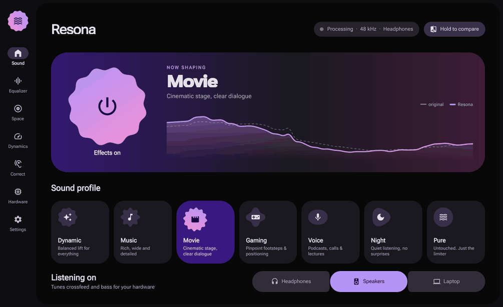
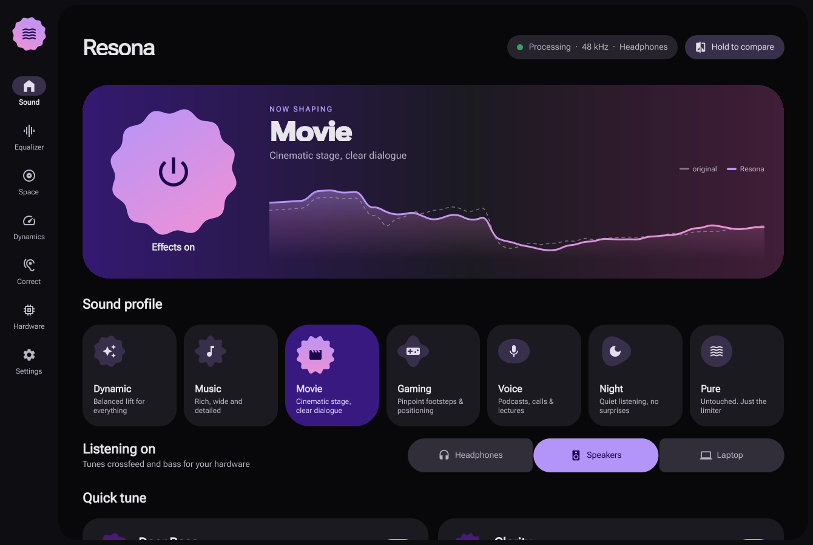
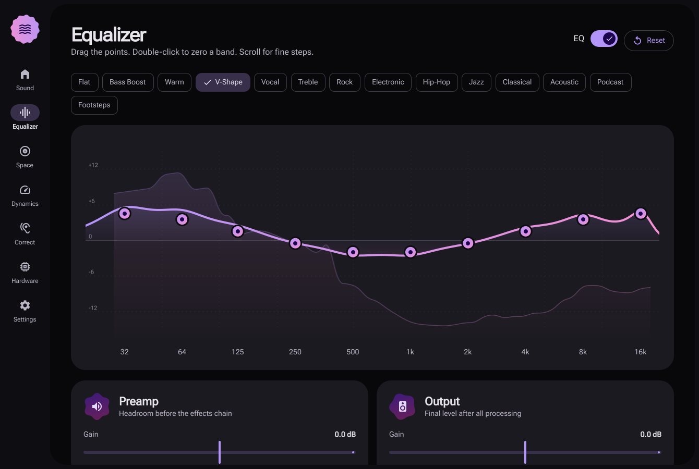
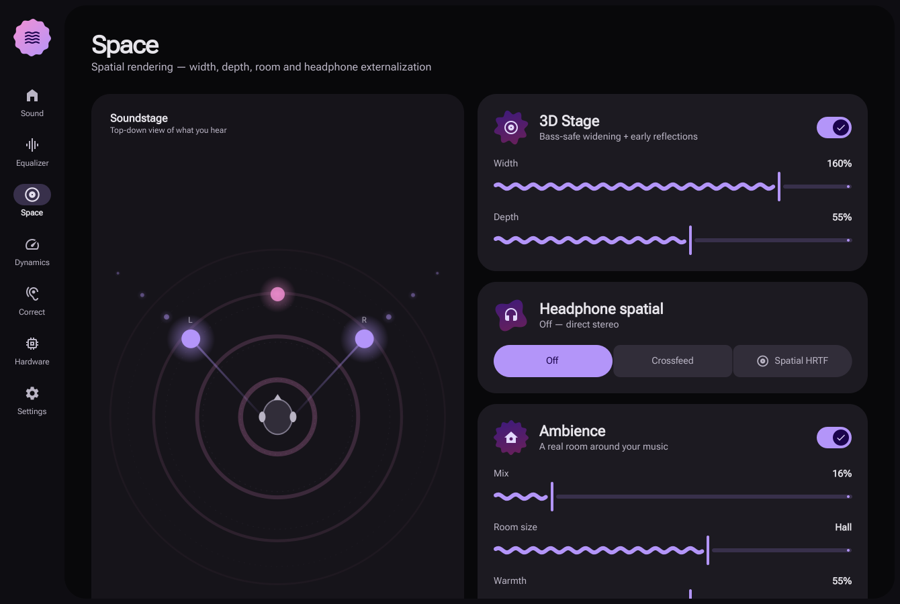
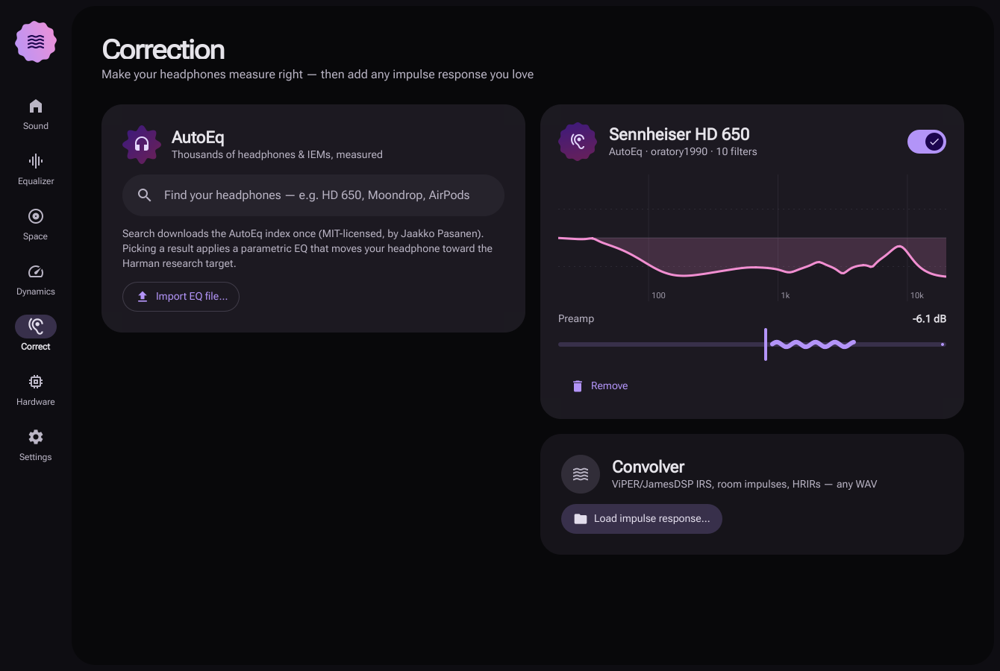
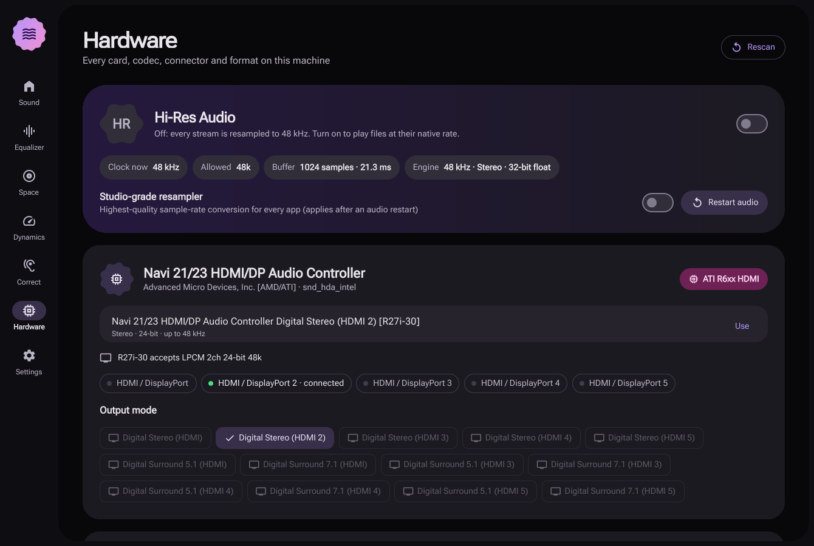
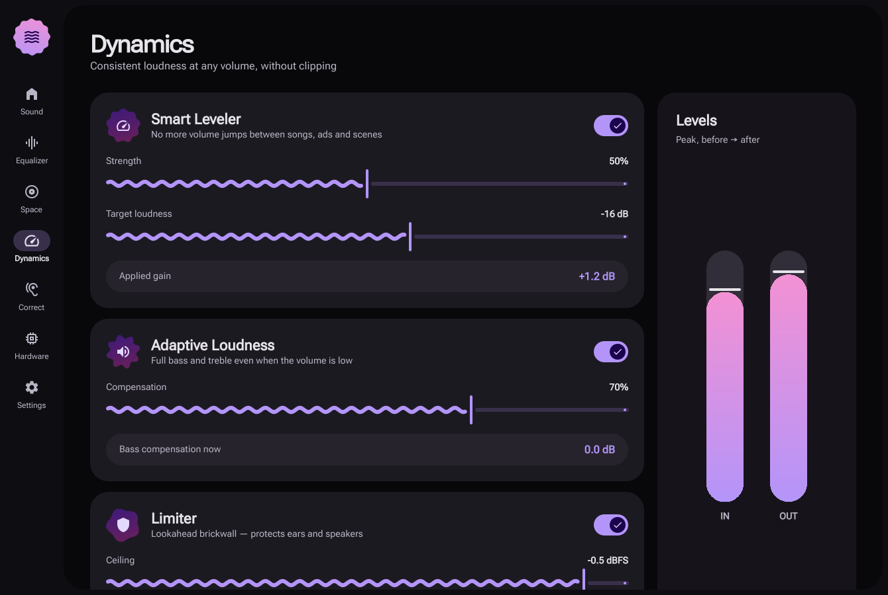

<div align="center">


# Resona

### The sound enhancer Linux never had.

Spatial audio, psychoacoustic bass, Intelligent EQ, headphone correction for about 8,800 models,<br>
surround upmixing for HDMI and optical, and Hi-Res playback, all in one native PipeWire engine<br>
with a Material 3 Expressive interface.

[](https://github.com/noble6/resona/actions/workflows/ci.yml)




</div>

---

Windows laptops ship with Dolby Atmos, DTS:X or a Realtek console. Android has Dolby, ViPER and JamesDSP. On Linux you hand-wire plugin chains in EasyEffects and hope.

**Resona is one switch.** Pick a profile (Music, Movie, Gaming, Voice, Night) and tell it whether you're on headphones, speakers or a laptop. It shapes everything you hear, system-wide, through its own realtime DSP engine.

## Features

| | |
|---|---|
| **Spatial HRTF** | Binaural virtual speakers for headphones (Brown–Duda structural head model: head shadow, interaural delay, pinna cues), equalized to stay tonally neutral |
| **DeepBass** | Psychoacoustic *missing-fundamental* bass. Harmonics your brain hears as sub-bass, so even laptop speakers sound big. Four voicings: **Balanced**, **Sub Boost** (real rumble at 40 to 60 Hz), **Punchy** (transient kick on every drum hit, less mud) and **Warm** (full low mids, soft even harmonics) |
| **Intelligent EQ** | Listens to what's playing and steers the long-term tonal balance toward a target (Balanced, Warm, Focused, Bright), song by song and scene by scene |
| **Surround upmix** | Stereo → 5.1 / 7.1 for HDMI receivers, analog 5.1 and **S/PDIF Dolby Digital (AC3)**. Correlation-steered dialogue centre, decorrelated surrounds, band-limited LFE |
| **Headphone correction** | Search **AutoEq's ~8,800 measured headphones** and apply one in a click. Imports EqualizerAPO / AutoEq `.txt` and **ViPER DDC `.vdc`** |
| **Convolver** | Load any IR: ViPER/JamesDSP **`.irs`**, room impulses, HRIRs. Mono, stereo or true-stereo, with dry/wet mix |
| **Smart Leveler** | Ends volume jumps between songs, ads and scenes, and is volume-aware so it never fights your volume knob |
| **Adaptive Loudness** | Equal-loudness compensation from the *actual* playback level: full bass at low volume |
| **Voice Focus** | Lifts presence in the centre channel only, so dialogue cuts through effects |
| **Clarity** | High-frequency harmonic exciter plus air shelf. Restores what lossy streaming takes away |
| **Tube Warmth** | Biased even-harmonic saturation: the glow of a valve amp |
| **3D Stage & Ambience** | Bass-safe M/S widening, asymmetric early reflections, 4-line FDN room |
| **Limiter** | Lookahead brickwall, linked across all 8 channels. Nothing ever clips |
| **10-band EQ** | Draggable curve over a live spectrum, plus 14 presets |

### Knows your hardware

- **Detects every card, codec and connector.** For example: *Realtek ALCS1200A, 24-bit, up to 192 kHz, Line Out connected, S/PDIF available*
- **Reads your display's audio capabilities (EDID/ELD)** over HDMI/DP: what your TV or receiver accepts
- **One-tap output modes**: stereo, analog 5.1, HDMI 5.1/7.1, S/PDIF optical, Dolby Digital AC3 encode
- **Hi-Res mode**: PipeWire follows each song's native rate (44.1, 88.2, 96, 192 kHz…) instead of resampling everything to 48 kHz
- **Studio-grade resampler** (quality 14) for every app
- **Bluetooth codec switching** (LDAC / aptX / AAC / SBC, whatever your adapter offers)

### Smart, like a phone

- **Per-device memory.** Headphones, speakers, HDMI and Bluetooth each keep their own sound
- **Per-app profiles.** Movie for mpv/VLC, Music for Spotify, Gaming for Steam/Wine, Voice for Discord, and you can add your own
- **Catches every app.** Games that open your speakers directly (FMOD/Wwise titles such as War Thunder) get routed through Resona automatically, so effects and the volume keys apply to them too
- **Follows your output.** Plug in headphones or switch devices from the tray and Resona moves with you
- **Hold to compare.** Instant A/B against the untouched signal
- **Presets** you can save, import and share as JSON
- **Updates itself** from GitHub releases: only when you ask, weekly or monthly. Automatic installs wait for a quiet moment, so music or a game is never cut off

## Screenshots

| Sound | Equalizer |
|---|---|
|  |  |
| **Space** | **Correction** |
|  |  |
| **Hardware** | **Dynamics** |
|  |  |

The interface is Material 3 Expressive, hand-built in QML: shape-morphing controls (cookie, flower, burst and clover polar shapes), wavy sliders that ripple while audio plays, springy motion, and dynamic color that re-tones the whole UI from one seed.

## How it compares

| | **Resona** | EasyEffects | JamesDSP (Linux) |
|---|:-:|:-:|:-:|
| One-click profiles + device modes | Yes | Manual chains | Partial |
| Binaural HRTF virtual speakers (no IR file needed) | Yes | Needs IR file | Needs IR file |
| Psychoacoustic bass | Yes | Yes (plugin) | Yes |
| Intelligent (content-adaptive) EQ | Yes | No | No |
| Stereo → 5.1/7.1 upmix + AC3 / HDMI output modes | Yes | No | No |
| Volume-aware leveler + loudness compensation | Yes | Partial | Partial |
| AutoEq search built in | Yes | Yes import | Yes |
| ViPER DDC + IRS convolver | Yes | IR only | Yes |
| Hardware / codec / HDMI ELD inspector, Hi-Res toggle | Yes | No | No |
| Per-device memory + per-app profiles | Yes | Yes (device) | Partial |
| Engine CPU | Reported by the offline DSP benchmark; depends on hardware and sample rate | depends on chain | low |

EasyEffects is still the right tool if you want an arbitrary plugin rack. Resona is for everyone who just wants their audio to sound great.

## Install

```sh
git clone https://github.com/noble6/resona && cd resona
./install.sh          # installs into ~/.local, no root needed
resona                # or open "Resona" from your app menu
```

Requirements: PipeWire with `pipewire-pulse` and WirePlumber (the default on every modern distro), Python ≥ 3.10, PySide6 (Qt ≥ 6.7), numpy, libatomic, a C compiler. Self-updates also use python-cryptography.

```sh
sudo pacman -S pyside6 python-numpy python-cryptography gcc make   # Arch / CachyOS / Manjaro
sudo dnf install python3-pyside6 python3-numpy python3-cryptography libatomic gcc make  # Fedora
sudo apt install python3-pyside6.qtquick python3-pyside6.qtwidgets python3-numpy python3-cryptography libatomic1 gcc make # Debian 13 / Ubuntu 24.10+
```

Arch users can also build `packaging/aur/PKGBUILD`.

Closing the window keeps Resona running when a system tray is available. Without a tray, closing exits. *Quit* from the tray restores your original output. `./uninstall.sh` removes the app and autostart entry, but keeps presets, settings, caches, and PipeWire configuration.

The installer stages the plugin, app, launcher, icon, and desktop entry before
replacing installed files. Installs to the same prefix are serialized. Publication
errors and catchable interruption signals restore the previous artifacts; if
recovery fails, the error reports retained backup workspaces for manual recovery.
Replacement is sequential, not an atomic switch of the entire installation.
A private transaction journal and flushed files/directories support recovery on
the next installer invocation after `SIGKILL` or a system crash: unfinished
publication restores previous artifacts; a committed transaction finishes cleanup.
Recovery is repeatable if interrupted again. Unsafe or missing recovery data stops
installation for manual recovery. Crash durability still depends on the filesystem
and storage honoring flushes; no process can recover an installation while the
machine is powered off. Interrupted staging can leave unused private temporary
files if the process dies before recording their paths.

Self-updates verify every release offline before installing it, with Resona's own
Sigstore verifier (`app/resona/sigstore_verify.py`) and the
[`cryptography`](https://cryptography.io) library most distros already ship. No GitHub
CLI is needed. Resona accepts only stable `x.y.z` releases with an attested source
archive and Sigstore bundle produced by this repository's `.github/workflows/release.yml`.
Before extraction or installation it checks:

- the signing certificate chains to Sigstore's Fulcio CA and has a valid embedded
  certificate-transparency timestamp
- the certificate identity: this repository, the exact release workflow, the release tag,
  the pinned source commit and a GitHub-hosted runner
- the signature over an SLSA provenance statement whose only subject is the downloaded archive
- the Rekor transparency-log entry: signed entry timestamp, Merkle inclusion proof and
  signed checkpoint

The trust anchors are a vendored copy of Sigstore's public trusted root. If a future
bundle format is not understood, Resona falls back to `gh attestation verify` when the
GitHub CLI is installed and otherwise refuses the update. A failed check is never
retried another way. The source must also declare the requested version. There is no
fallback to unsigned source archives; older releases without these assets require a
manual update.

Source downloads are limited to 64 MiB, attestation bundles to 4 MiB, decompressed
archives to 256 MiB and 20,000 entries. Archives may contain only regular files and
directories. Publishing a new stable GitHub release triggers source packaging and
keyless attestation signing; no maintainer private signing key is stored. Existing
releases are not automatically republished or signed retroactively.

## How it works

```
apps ──► "Resona Sound" virtual sink ─► PipeWire filter-chain (own process, RT priority)
                                            │
                     [optional convolver] ──┤
                                            ▼
                               resona.so  (LADSPA · C · lock-free · 32-bit float)
                               label "resona" (2→2) or "resona_surround" (2→8)
                                            │  ▲
                        meters, spectrum,   │  │  parameters, correction filters
                        Intelligent EQ      ▼  │  (no restarts, sample-accurate smoothing)
                               /dev/shm/resona-$UID  ◄──►  Resona UI (PySide6 + QML)
                                            │
                                            ▼
                                your real output: headphones · speakers · HDMI · S/PDIF · USB · BT
```

See **[docs/DSP.md](docs/DSP.md)** for a walk through every block, with the math. Because the engine is plain LADSPA, `resona.so` also loads in any LADSPA host.

## Tested

```sh
make -C engine test                  # 60+ offline DSP checks at 44.1 / 48 / 96 / 192 kHz
                                    # plus HRTF reference and concurrent control-publication checks
python3 tests/test_units.py --net    # parsers, presets ↔ engine contract, live AutoEq + real JamesDSP DDC
python3 tests/test_pipewire.py       # live PipeWire: passthrough, live EQ, AutoEq, 5.1 upmix, convolver
python3 tests/test_routing_live.py   # default-sink takeover, device following, volume sync, restore
python3 tests/test_capture_live.py   # games that bypass the default device get routed back through Resona
bash tests/run_pipewire.sh          # all live suites and UI smoke test on a private audio server
```

For an opt-in end-to-end release check:

```sh
python3 tests/verify_release_upgrade.py --from-tag v2.2.2 --with-ui
```

This requires the normal build/runtime dependencies, `python-cryptography`, and
`gh` for an independent signature check. It downloads genuine signed assets,
cross-checks native and GitHub CLI verification, rejects a modified archive,
installs the older release into a temporary prefix, and runs that installed
copy's updater against the latest stable release. It checks settings/preset
preservation and optionally launches the upgraded installed app on private
PipeWire. No release is published and the user's installation is not changed.
Use `--to-tag` to assert the expected latest release. This network/build test is
not part of the offline CI suites.

The 1.5 ms figure is DSP lookahead, not end-to-end playback latency. PipeWire
buffers, convolution, resampling, and the output device add their own delay.
DSP benchmark output reports percent of one CPU core at each tested sample rate;
sanitizer builds are for correctness checks, not performance measurements.

Some of what these suites verify: bit-transparent output with effects neutral; EQ within 0.01 dB; a limiter that never exceeds its ceiling on full-scale noise in 2 or 8 channels; NaN/Inf-safe processing; HRTF tonal balance within ±1.5 dB with a 270 µs interaural delay; Intelligent EQ taming a boomy mix; dialogue steered to the centre speaker while hard-panned instruments stay put.

## Shortcuts

`Ctrl+1…7` switch pages · `Space` toggles effects · scroll on any slider or EQ point for fine steps · double-click an EQ point to zero it

## Contributing

PRs are welcome, especially new profiles, translations, distro packages and DSP ideas. Start with [CONTRIBUTING.md](CONTRIBUTING.md). Run the test suites before sending DSP changes.

## Credits

- **[Madaboutpawz](https://github.com/Madaboutpawz)** for everything
- **[rajdeep-3305](https://github.com/rajdeep-3305)**: contributor, tech support and fixes across the app
- **[AutoEq](https://github.com/jaakkopasanen/AutoEq)** by Jaakko Pasanen (MIT): the headphone measurements and correction filters, fetched on demand
- **[JamesDSP](https://github.com/Audio4Linux/JDSP4Linux)** (GPL-3.0): reference for the ViPER-DDC file format and the IRS ecosystem
- **C. P. Brown & R. O. Duda**, *A Structural Model for Binaural Sound Synthesis* (IEEE TSAP, 1998): the HRTF model
- **R. Bristow-Johnson**, *Audio EQ Cookbook*: biquad designs
- **[Roboto Flex](https://github.com/googlefonts/roboto-flex)** (OFL-1.1) and **Material Symbols** (Apache-2.0)
- Inspired by what Dolby Atmos, DTS and the Android audio-mod scene (ViPER4Android, JamesDSP, LunarisDolby) offer users

Resona contains **no proprietary code**. Every algorithm is implemented from scratch or from public research. Dolby, DTS and Realtek are trademarks of their respective owners; Resona is not affiliated with them.

## License

GPL-3.0-or-later. See [LICENSE](LICENSE).
